# GWS2AD

**Keep Active Directory in step with Google Workspace, from one simple web page.**

**[Website: gws2ad.jonnytech.dev](https://gws2ad.jonnytech.dev)** &nbsp;·&nbsp;
[What is this?](#what-is-this) &nbsp;·&nbsp;
[Try it in 5 minutes](#quick-start-demo-mode-about-5-minutes) &nbsp;·&nbsp;
[Screenshots](#screenshots) &nbsp;·&nbsp;
[Going live](#going-live-your-real-google-workspace-and-active-directory) &nbsp;·&nbsp;
[Docs](#documentation)

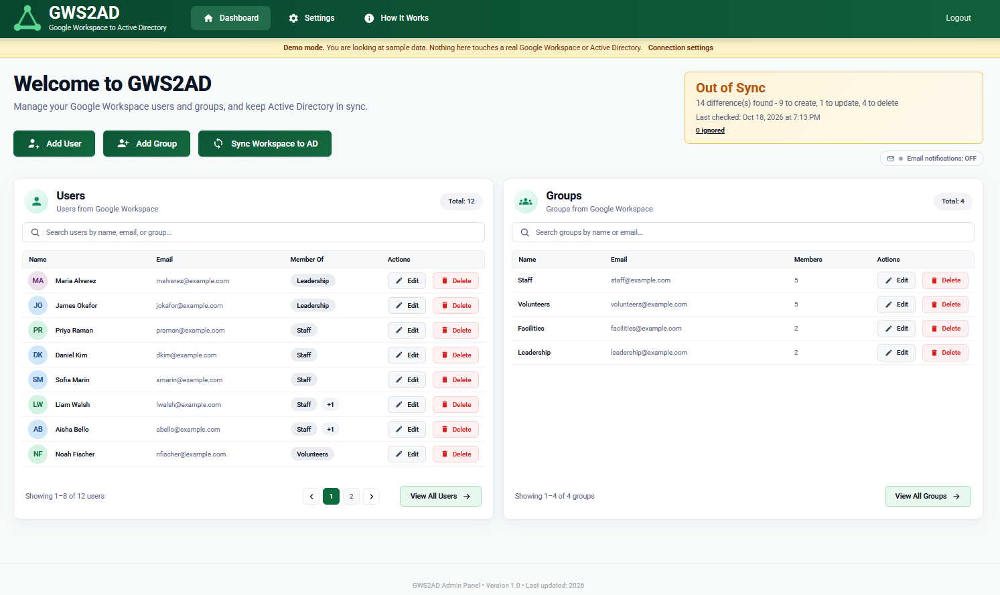

## What is this?

Many organizations keep their people in two places:

- **Google Workspace** for email, Drive and Docs.
- **Active Directory (AD)**, Microsoft's system for logging in to Windows computers, file servers and printers.

Without help, an admin adds every new person, group and password change in both places by hand. GWS2AD does that second part for you.

1. You make the change in Google (or right in GWS2AD's dashboard).
2. GWS2AD shows you a **preview** of what it plans to change in AD.
3. You read it and press **Confirm**. AD now matches Google.

**Nothing changes until you approve the preview.** It also starts in **Demo mode** with made-up people, so you can try everything
in about five minutes without touching a real system.

### Words used in this guide

- **Sync:** make AD match Google.
- **User, group:** a person's account, and a set of people such as "Staff".
- **OU (organizational unit):** a folder that holds users, in Google and in AD.
- **Demo mode / Live mode:** practice with fake data / your real systems.
- **Owner:** the first account you create. It can do everything.

> **Status:** built as a senior capstone project and used on a real network. It has a thorough automated test suite
> (see [Tests](#tests)), but it is young software that can create, change and delete accounts in a real directory.
> Read [Before you go live](#before-you-go-live) first.

## What it can do

- **Preview first.** See every user, group and change before anything happens, including anything that would be deleted.
- **Manage from one page.** Add, edit and delete Google Workspace users and groups, set passwords, change group members and move people between OUs.
- **Copy your OU layout** into AD, creating the OUs it needs and removing empty ones Google no longer has.
- **Safe sign-in.** Everyone must use an authenticator app (two-step verification). There are lockouts and recovery codes.
- **Roles.** One Owner, Admins, and roles like "Help Desk" that can do only what you allow.
- **Self-service password reset.** A small second page, started with the app on its own port. People get a code at their work email and set one new password for both Google and AD. See [docs](docs/password-reset-portal.md).
- **History and backups.** A log of sign-ins, changes and syncs, and a backup of your Google data before every sync.

## Screenshots

All of these are the Demo mode sample data (a made-up company, `example.com`). Nothing here is a real person or network.
The same tour, with more detail, is on the [website](https://gws2ad.jonnytech.dev).

### Read the plan, then sync

The sync preview opens before anything changes. A summary line counts what will happen, **deletes come first**, and the
confirm button shows how many deletions it will run. **Keep in AD** leaves an item alone, and you can say why.

<table>
<tr>
<td width="50%" valign="top">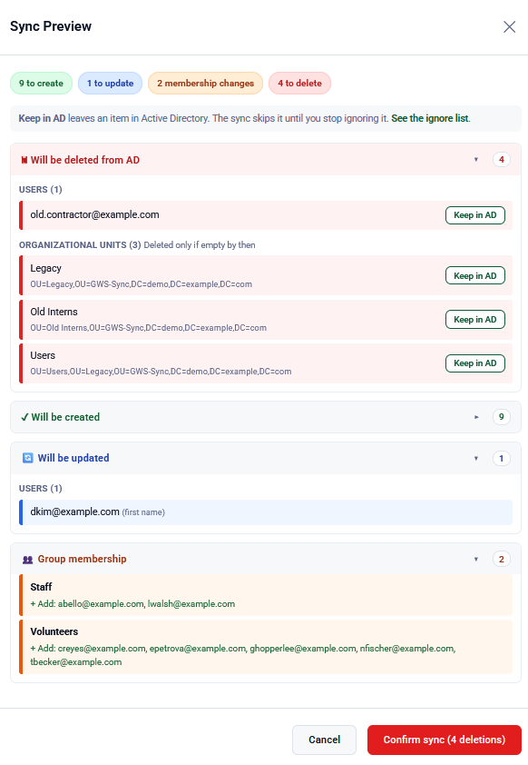<br><sub><b>Sync preview.</b> Deletes first, with a cost on the confirm button.</sub></td>
<td width="50%" valign="top">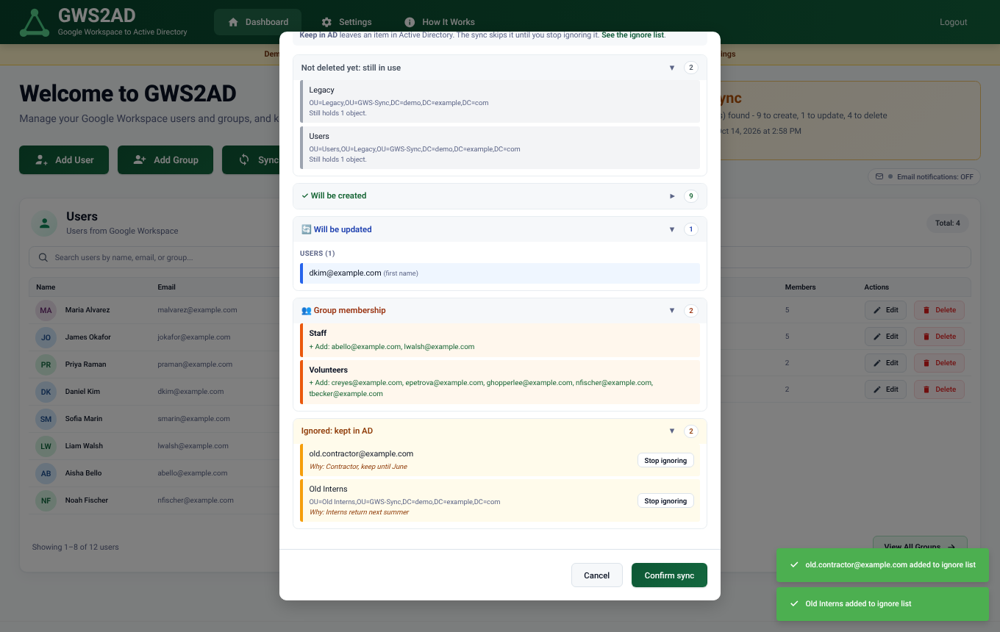<br><sub><b>Ignored items</b> drop to the bottom, with the note saying why.</sub></td>
</tr>
</table>

### Users and groups

<table>
<tr>
<td width="50%" valign="top">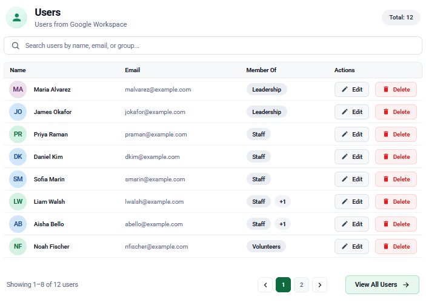<br><sub><b>Users.</b> Search, page, edit or delete.</sub></td>
<td width="50%" valign="top">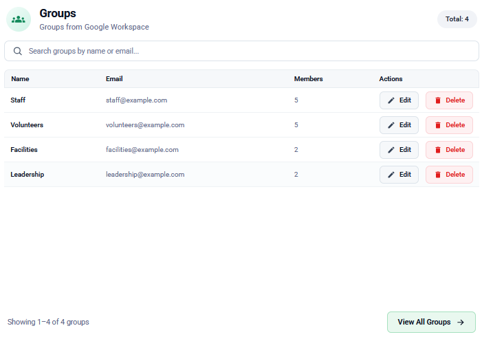<br><sub><b>Groups</b>, with member counts.</sub></td>
</tr>
<tr>
<td width="50%" valign="top">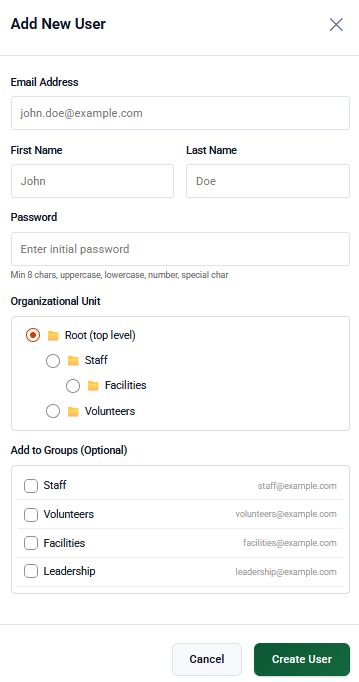<br><sub><b>Add a user.</b> Pick the OU from a tree and choose groups.</sub></td>
<td width="50%" valign="top">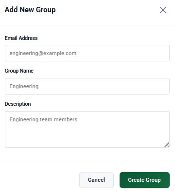<br><sub><b>Add a group.</b></sub></td>
</tr>
</table>

### Roles, accounts and the ignore list

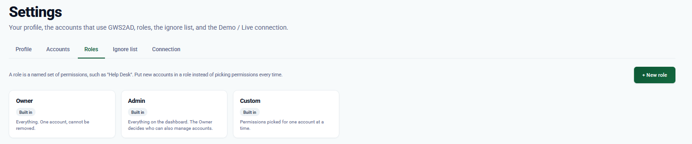
<sub><b>Roles.</b> A named set of permissions, such as "Help Desk".</sub>

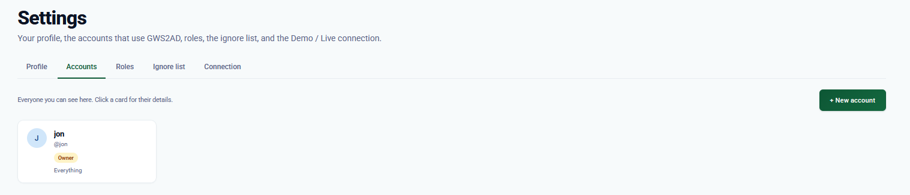
<sub><b>Accounts.</b> Who can sign in, and as what.</sub>

<table>
<tr>
<td width="50%" valign="top">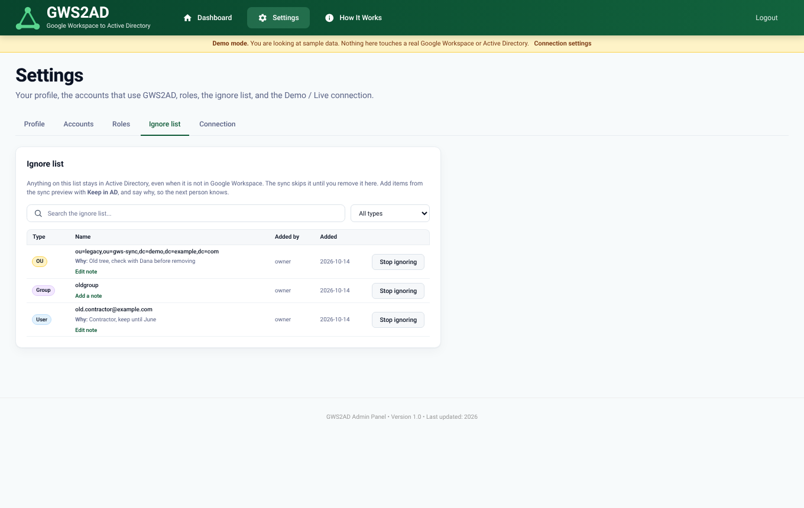<br><sub><b>Ignore list.</b> Type, who added it, when, and a note. Search and filter.</sub></td>
<td width="50%" valign="top"><br><sub><b>Keep in AD</b> opens a small "Why?" box in the row.</sub></td>
</tr>
</table>

### Built-in guidance

<table>
<tr>
<td width="50%" valign="top">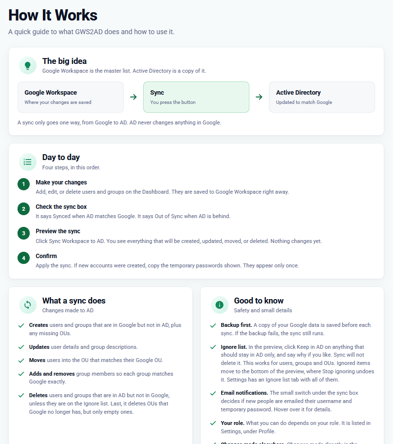<br><sub><b>How It Works.</b> A plain-words guide inside the app.</sub></td>
<td width="50%" valign="top">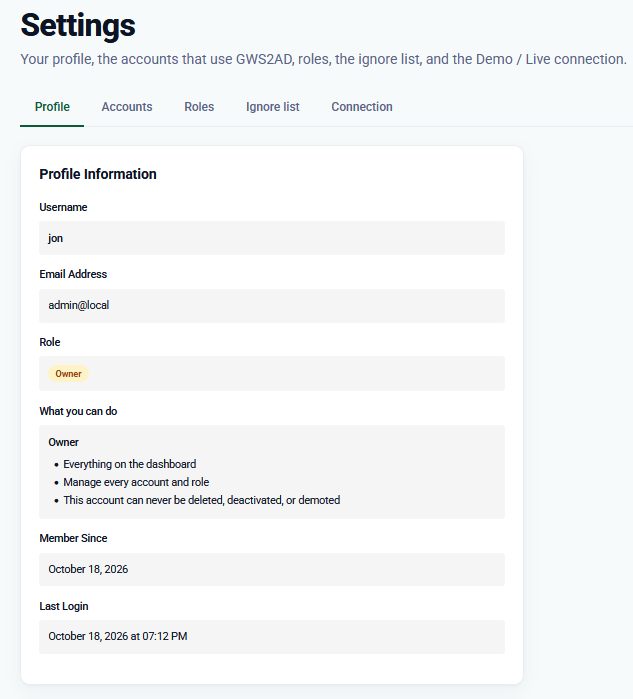<br><sub><b>Your profile.</b> Your role, and what it lets you do.</sub><br><br>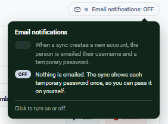<br><sub><b>Tooltips</b> explain the small switches.</sub></td>
</tr>
</table>

## Quick start (Demo mode, about 5 minutes)

Demo mode is a safe practice run. It uses pretend data, so nothing real is touched and you need no Google or Active Directory
details. You need Python 3.10 or newer. It works on Windows, macOS and Linux.

**1. Install it.**

```bash
git clone https://github.com/<your-account>/gws2ad.git
cd gws2ad

python -m venv venv
# Windows:  venv\Scripts\activate        macOS/Linux:  source venv/bin/activate
pip install -r requirements.txt
```

**2. Create your login.** This asks for a username and password for the web app (the "Owner" account).

```bash
python setup_secrets.py
```

**3. Start the app and open it** at http://localhost:5000.

```bash
python app.py
```

**4. Sign in and set up two-step verification.** Sign in as the Owner you just created. The app then asks you to:
scan the QR code with an authenticator app (Google Authenticator, Microsoft Authenticator, Authy, 1Password...),
type the 6-digit code, and save your recovery codes.

**5. Try a sync.** You land on a dashboard full of sample people. Click **Sync Workspace to AD**, read the preview, and confirm.

That is it. The yellow banner on every page reminds you that you are in Demo mode. The sample data resets whenever the app
restarts, or from **Settings > Connection > Reset**.

### Good to know

- **Step 2 created two files** next to `app.py`: `secrets.json.enc` (your settings, encrypted) and `.env` (the key that unlocks them).
  Both are git-ignored. **Back up `.env`.** Without it the settings file cannot be read and you would run setup again.
- **The username and password from step 2 are used once**, the first time the app starts. After that, change them in the app
  (Settings > Profile).

<details>
<summary><b>What the sample data looks like</b></summary>

<br>

Twelve people at a made-up "Northwind Community Center" (`example.com`), in a small OU tree (`/Staff`, `/Staff/Facilities`,
`/Volunteers`) and four groups. The pretend Active Directory already holds seven of them (one with a different first name), plus
one account and one empty OU that Google does not have. So your first sync shows a bit of everything: creates, an update,
deletes and group membership changes.

</details>

## Going Live (your real Google Workspace and Active Directory)

Going live means the app reads your real Google Workspace and writes to your real Active Directory. The code is the same as in Demo
mode. The only difference is which systems it talks to. Do these steps in order. Most of the work is on the Google and AD side, and it
is a one-time setup.

**You will need:** a Google Workspace super admin, someone who can create a Google Cloud project, a Domain Admin for Active Directory,
a domain controller reachable over LDAPS, and a mailbox for notification emails.

**Step 1. Set up Google and Active Directory.** Follow [docs/going-live.md](docs/going-live.md). It covers a Google Cloud project with
the Admin SDK API, a service account with domain-wide delegation, a least-privilege AD service account, LDAPS, and a mail account.
When you finish, you will have these ready:

- the Google service account key file (a `.json` file)
- the email of a Google super admin the app can act as
- your domain controller's name
- the AD location the sync may change (the base DN)
- the AD service account and its password
- the mail account details

**Step 2. Put the Google key in the `keys/` folder**, for example `keys/sa-key.json`. This file is how the app proves to Google that it is
allowed to read your users and groups. The folder is git-ignored. Never commit or share the key. It is only needed in Live mode.

**Step 3. Save your details on the server.** Run this in the app folder:

```bash
python setup_secrets.py --live
```

It asks one question at a time. Here is what each one means:

*Google Workspace*
- **Path to the service account key:** `keys/sa-key.json` (where you put it in step 2)
- **Super admin email:** the admin the app acts as, for example `gws2ad-admin@example.com`
- **Customer ID:** press Enter to keep `my_customer`

*Active Directory*
- **Domain controller host name:** for example `dc01.corp.example.com`. The app connects over LDAPS, port 636.
- **Base DN:** the one part of AD the sync is allowed to change, for example `OU=GWS-Sync,DC=corp,DC=example,DC=com`. A dedicated OU is safest.
- **Service account DN or user principal name, and its password:** the AD login the sync uses, for example `svc_gws2ad@corp.example.com`

*Email* (new people get their temporary password this way)
- **Mail server and port:** press Enter to keep `smtp.gmail.com` and `587`
- **Send-from address and its password:** for Gmail, use an App Password, not the normal password

Every question needs an answer, including email. If you skip one, nothing is saved. You can run the command again any time: your saved
answers show as defaults, and pressing Enter on a password keeps the saved one. Passwords and keys are typed here on the server, never
into the web page.

**Step 4. Switch on Live mode.** Restart the app, sign in as the Owner, and open **Settings > Connection**. Press
**Run connection check**. It signs in to Google, AD and the mail server and shows a tick or a cross for each, with the reason.
When all three pass, press **Go Live** (it asks for your current 6-digit code). If any check fails, the app stays in Demo mode. You can
return to Demo mode at any time.

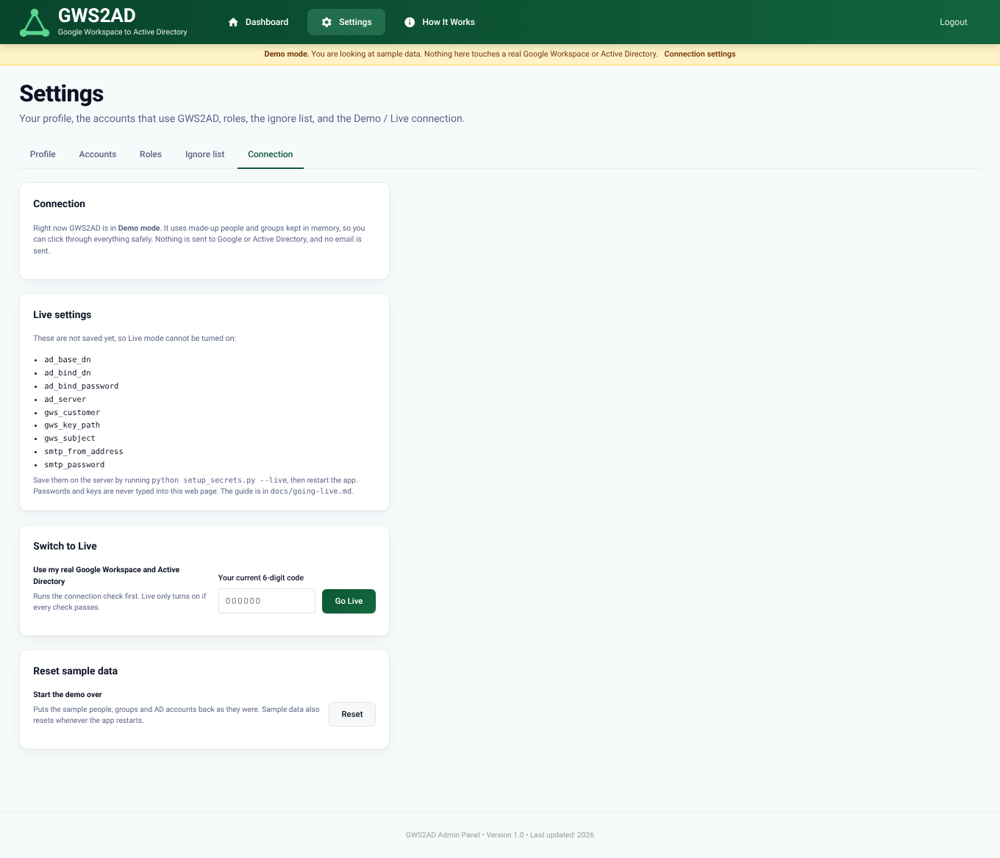

## Before you go live

Read these five points first. They keep your real data safe.

- **A sync can delete things.** If a user or group is in AD but not in Google, the sync deletes it from AD. The same goes for empty OUs
  that Google no longer has. If you want to keep something, click **Keep in AD** in the preview (you can add a note saying why).
  Group members are matched exactly too: someone in an AD group but not in the Google group is removed from it. **Always read the preview.**
- **Give the sync its own small OU.** Use a dedicated OU as the base DN (for example `OU=GWS-Sync,DC=corp,DC=example,DC=com`) and give the
  AD service account rights on that OU only. Then nothing outside it can be seen or changed.
- **It only goes one way.** Google to AD. The sync never changes Google and never reads passwords back. A password you set on the
  dashboard is saved to both.
- **Passwords travel over a secure connection only** (LDAPS, port 636). AD refuses to set passwords over a plain connection.
- **Try it on a test OU first.** The automated tests use stand-ins for Google and AD, never a real directory. The sync has run against a real
  Google Workspace and AD domain, but your setup may differ.

More in [docs/security.md](docs/security.md), including known limitations.

## How it works

```
 Google Workspace  ──read──▶  GWS2AD  ──preview──▶  you approve  ──write──▶  Active Directory
 (users, groups, OUs)                                                     (users, groups, OUs)
```

1. **Read Google:** users, groups, group members and OUs.
2. **Read AD:** what is there now, under the base DN.
3. **Compare.** People are matched by email address. Groups are matched by their AD account name.
4. **Preview.** You see what would be created, updated, moved or deleted, and who joins or leaves each group.
5. **Back up, then apply.** Your Google data is saved to `data_backup/` first, and every step is logged.

New AD accounts get a random temporary password. It is emailed to the person (if email is on) or shown to you once on screen.
It is never saved in the logs.

Full detail is in [docs/how-it-works.md](docs/how-it-works.md). The app also has a plain-language **How It Works** page built in.

## Documentation

| I want to... | Read |
|---|---|
| Understand the sync step by step | [docs/how-it-works.md](docs/how-it-works.md) |
| Connect my real Google and AD | [docs/going-live.md](docs/going-live.md) |
| Know what a setting or file does | [docs/configuration.md](docs/configuration.md) |
| Decide who gets which permissions | [docs/roles-and-permissions.md](docs/roles-and-permissions.md) |
| See how it is protected, and its limits | [docs/security.md](docs/security.md) |
| Run it on a server (HTTPS, Windows service) | [docs/deployment.md](docs/deployment.md) |
| Let people reset their own password | [docs/password-reset-portal.md](docs/password-reset-portal.md) |
| Fix a problem | [docs/troubleshooting.md](docs/troubleshooting.md) |
| Run the tests | [docs/testing.md](docs/testing.md) |
| Report a security problem | [SECURITY.md](SECURITY.md) |

## A tour

| | |
|---|---|
| 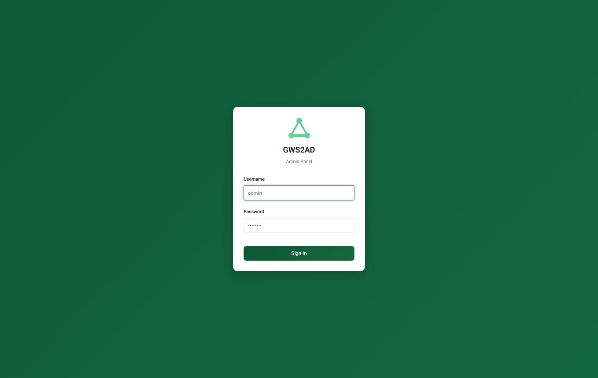 **Sign in** | 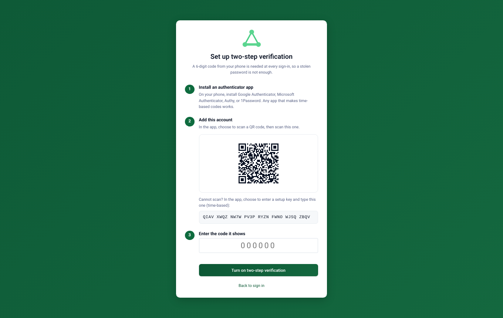 **Two-step setup** (required for everyone) |
| 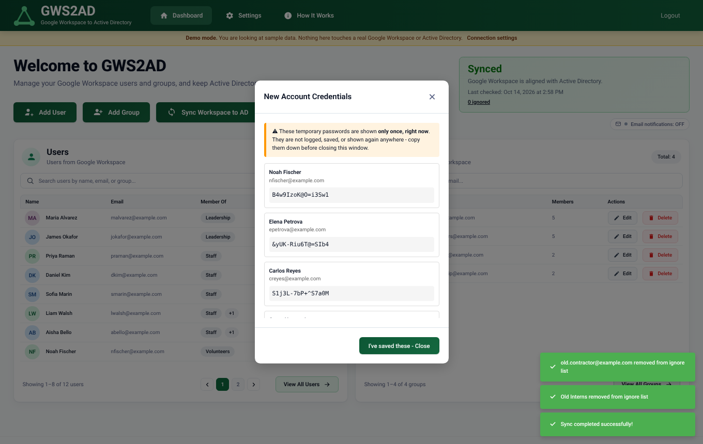 **Temporary passwords shown once** | 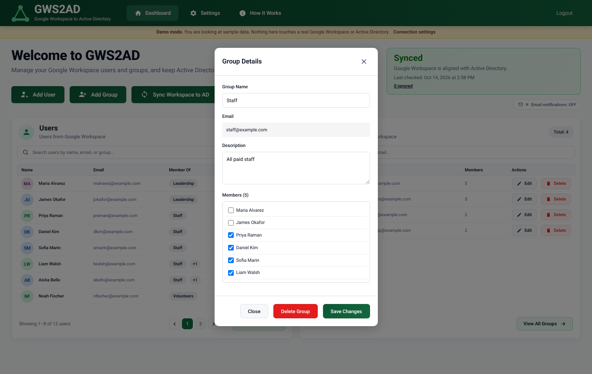 **Edit a group and its members** |

More: [new role](docs/images/13-new-role.png), [new account](docs/images/15-new-account.png),
[account detail](docs/images/16-account-detail.png), [your profile and two-step](docs/images/12-settings-profile.png),
[recovery codes](docs/images/03-recovery-codes.png).

<details>
<summary><b>Project layout</b> (for developers)</summary>

```
app.py                 Flask app: pages and the /api routes
config.py              loads the encrypted secrets; Demo needs none of the live values
mode.py                Demo / Live switch (a small file, so it survives restarts)
mock_connectors.py     the pretend Google Workspace and Active Directory used in Demo
gws_connector.py       real Google Workspace (Admin SDK Directory API)
ad_connector.py        real Active Directory (LDAPS via ldap3)
sync_engine.py         compare, preview and apply; notification email
directory_cache.py     keeps the dashboard fast and accurate despite Google's lag
connection_test.py     read-only checks run before going Live
database.py            SQLite models, upgrades
auth.py  permissions.py  passwords.py  twofa.py  loginlock.py     sign-in and the access rules
backup.py  file_logger.py                                         pre-sync snapshot, log files
setup_secrets.py       first-run setup (Demo) and --live setup
reset_2fa.py  unlock_account.py                                   emergency tools, run on the server
generate_cert.py  generate_csr.py  convert_pfx_to_pem.py          HTTPS helpers
install-windows-service.ps1                                       run it as a Windows service
templates/  static/    the web pages
tests/                 automated tests
docs/                  guides and screenshots
```

</details>

## Tests

```bash
python tests/run_all.py
```

Thirteen suites: rules for permissions, two-step verification, lockouts, the cache and the setup prompts; and end-to-end tests that drive the real
app (sign-in, enrolment, accounts, roles, lockouts, Demo mode and the Demo/Live switch, OU cleanup, the ignore list, the password reset page, branding) on a throwaway copy with a controllable clock.
See [docs/testing.md](docs/testing.md).

## Contributing

Issues and pull requests are welcome. Please run `python tests/run_all.py` first, and never commit real credentials
(`.gitignore` already excludes `.env`, `secrets.json.enc`, databases, keys and certificates).

## License

Free to use, not free to modify. You may run GWS2AD for any purpose at no cost. You may not edit, resell, or build on the code without written permission. Changing settings and the `.env` file is normal use and is allowed. See [LICENSE](LICENSE).

Showcase site: [gws2ad.jonnytech.dev](https://gws2ad.jonnytech.dev)
