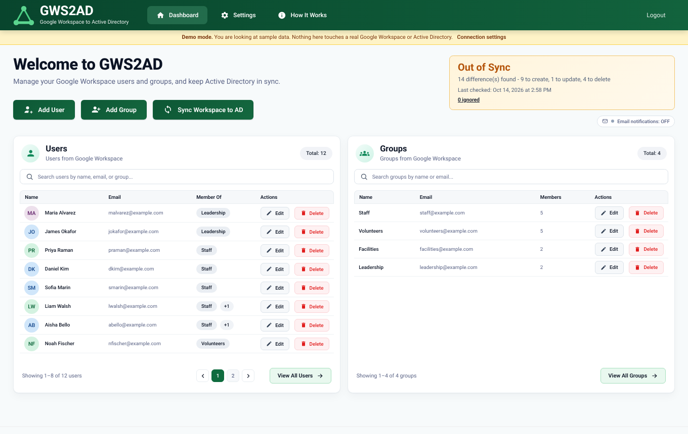
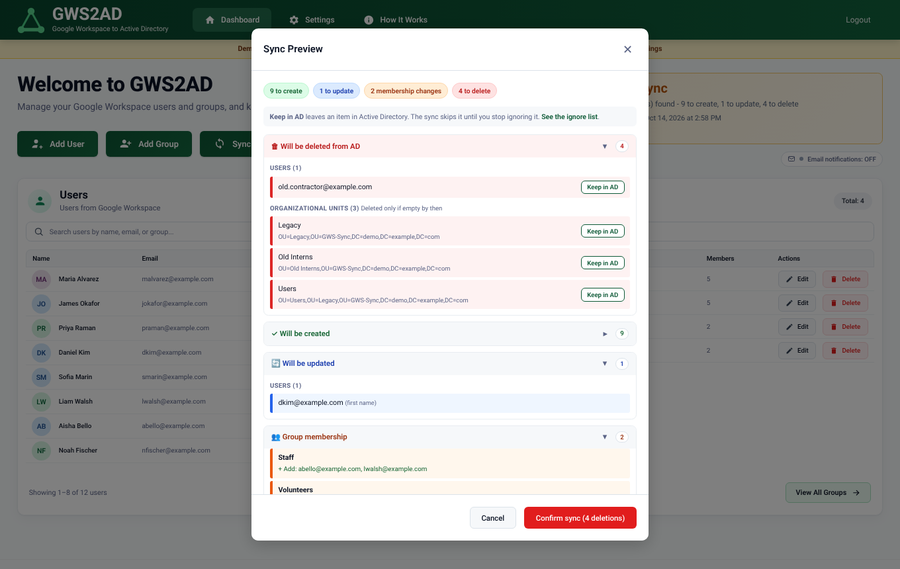
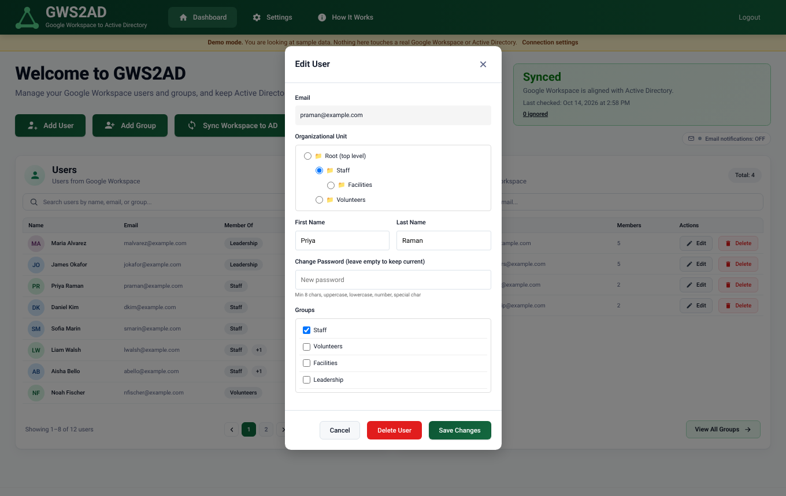
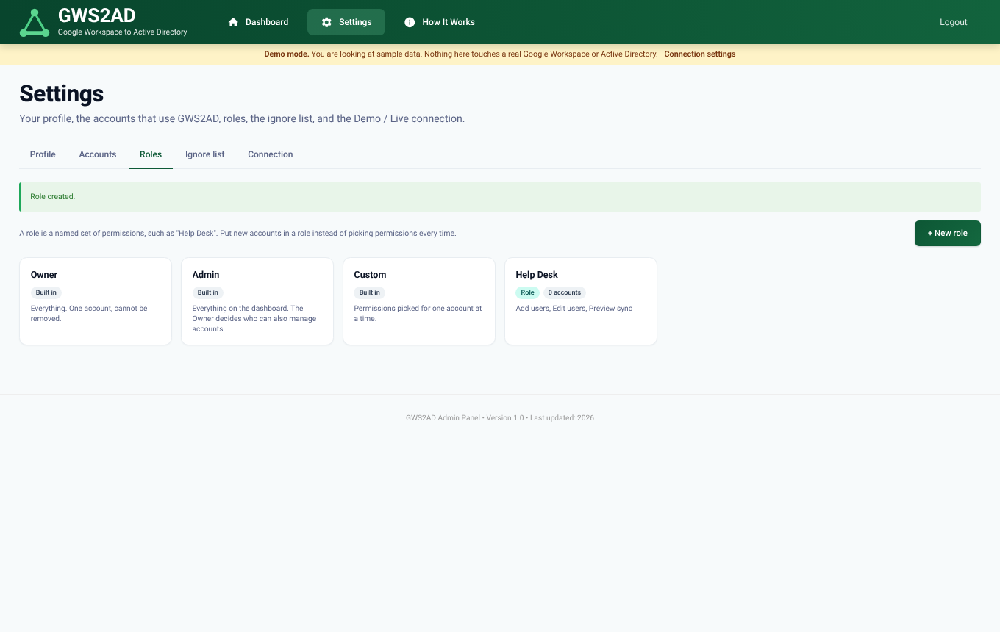
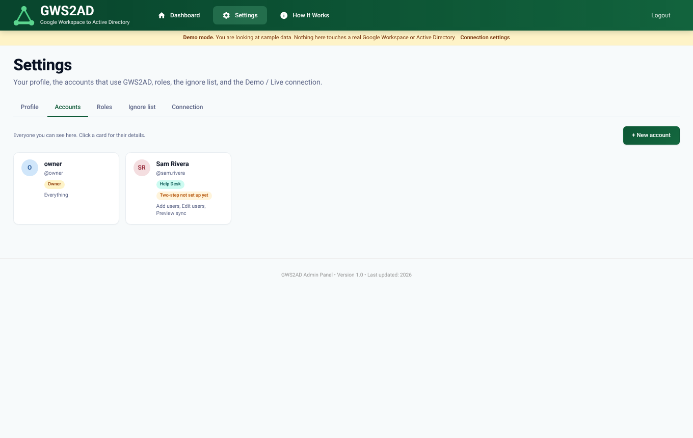

# GWS2AD

**A web admin portal that keeps Active Directory in step with Google Workspace.**
Manage users and groups in one place, preview exactly what a sync will change, then apply it.

It starts in **Demo mode** on made-up sample data, so you can try every feature in a few minutes
with no Google or Active Directory credentials. When you are ready, the Owner flips one setting to **Live**.



> **Status:** built as a senior capstone project and used on a real network. It has a thorough
> automated test suite (see [Tests](#tests)), but it is young software that can create, change and delete
> accounts in a real directory. Read [Know before you go live](#know-before-you-go-live) first.

---

## What it does

- **Google Workspace is the source of truth.** The app reads users, groups and organizational units (OUs)
  from Google, compares them with Active Directory, and makes AD match.
- **Preview before anything changes.** The sync preview lists every user, group, OU and membership change,
  and anything that would be deleted, so a person approves it first.
- **Manage from one page.** Add, edit and delete Google Workspace users and groups, set passwords,
  change group membership and move people between OUs, from the dashboard.
- **Mirrors your OU structure** into AD, creating the OUs it needs.
- **Locked-down sign-in.** Every account must use an authenticator app (two-step verification), with
  lockouts, recovery codes and a code re-check for sensitive actions.
- **Roles and permissions.** One Owner, Admins, and custom roles such as "Help Desk" with exactly the
  permissions you choose.
- **Audit trail** of sign-ins, account changes, syncs and mode switches.
- **Backup before every sync:** a JSON snapshot of Google users, groups and OUs.

| Sync preview | Edit a user |
|---|---|
|  |  |

## Quick start (Demo mode, about 5 minutes)

You need Python 3.10 or newer. Works on Windows, macOS and Linux in Demo mode.

```bash
git clone https://github.com/jonnytech-dev/gws2ad.git
cd gws2ad

python -m venv venv
# Windows:  venv\Scripts\activate        macOS/Linux:  source venv/bin/activate
pip install -r requirements.txt

python setup_secrets.py        # asks only for an Owner username and password
python app.py                  # then open http://localhost:5000
```

1. Sign in as the Owner you just created.
2. You are asked to set up **two-step verification**: scan the QR code with an authenticator app
   (Google Authenticator, Microsoft Authenticator, Authy, 1Password...), type the 6-digit code, and save your recovery codes.
3. You land on a dashboard full of sample people. Click **Sync Workspace to AD**, read the preview, and confirm.
   Nothing real is touched: Demo mode uses an in-memory pretend Google Workspace and pretend Active Directory.

The yellow banner on every page reminds you that you are in Demo mode. The sample data resets whenever the app
restarts, or from **Settings > Connection > Reset**.

**What the sample company looks like:** twelve people at "Northwind Community Center" (`example.com`) in a small OU tree
(`/Staff`, `/Staff/Facilities`, `/Volunteers`) and four groups. The pretend AD already holds seven of them, one with a different
first name, plus one account that no longer exists in Google, so the first sync has creates, an update, a delete and
membership changes to show.

## Going Live (your real Google Workspace and Active Directory)

Demo mode and Live mode run the same code. The only difference is which connectors answer.

1. Do the one-time setup on the Google and AD side. The complete walk-through is in
   [docs/going-live.md](docs/going-live.md): a Google Cloud project with the Admin SDK API, a service account with
   domain-wide delegation, a least-privilege AD service account, LDAPS, and a mail account for notifications.
2. Save the details on the server (never in the browser):
   ```bash
   python setup_secrets.py --live
   ```
3. Restart the app, sign in as the Owner, open **Settings > Connection**, press **Run connection check**,
   then **Go Live** (it asks for your current 6-digit code).

Live is only switched on when the check signs in to Google, AD and the mail server successfully. You can return to Demo
mode at any time.


## Know before you go live

- **A sync can delete.** Users and groups that exist in AD (under your base DN) but not in Google are deleted from AD,
  unless you put them on the **ignore list** from the preview. Group membership is also a full mirror: people in an AD group
  who are not in the Google group are removed from it. Always read the preview.
- **Use a dedicated OU as your base DN** (for example `OU=GWS-Sync,DC=corp,DC=example,DC=com`) and delegate the service account
  permissions on that OU only. Then nothing outside it is visible to, or changeable by, the sync.
- **Sync is one way:** Google to AD. Passwords you set on the dashboard are written to both, but sync never reads
  passwords back or writes to Google.
- **Passwords go over LDAPS only.** AD will not accept `unicodePwd` over plain LDAP; the app uses port 636.
- **Try Live on a test OU first.** The automated tests use stand-ins for Google and AD, never a real directory. The sync and connectors
  have run against a real Google Workspace and AD domain, but your environment may differ.

More in [docs/security.md](docs/security.md), including known limitations.

## How it works

```
 Google Workspace  ──read──▶  GWS2AD  ──compare / preview──▶  you approve  ──write──▶  Active Directory
 (users, groups, OUs)      (Flask + SQLite)                                          (users, groups, OUs)
```

1. **Pull** everything from Google (users, groups, members, OUs) through the Admin SDK Directory API.
2. **Pull** the current state of AD from under the base DN over LDAPS.
3. **Compare.** Users are matched by email (falling back to the AD `userPrincipalName`); groups by their AD account name.
4. **Preview.** You see creates, updates, moves, membership changes and deletions.
5. **Back up** Google's data to `data_backup/`, then **apply**, logging every step.
6. New accounts get a random temporary password. It is emailed to the person (if email is on) or shown to you once on screen. It is
   never written to the log or the audit trail.

Full detail, including OU mirroring and the data cache, is in [docs/how-it-works.md](docs/how-it-works.md). The app also has a
plain-language **How It Works** page built in.

## Documentation

| Guide | What is in it |
|---|---|
| [docs/how-it-works.md](docs/how-it-works.md) | The sync step by step, OU mirroring, the cache, Demo vs Live |
| [docs/going-live.md](docs/going-live.md) | Google Cloud, domain-wide delegation, AD service account and delegation, LDAPS, mail |
| [docs/configuration.md](docs/configuration.md) | Every setting, the secrets file, `.env`, session timeout |
| [docs/roles-and-permissions.md](docs/roles-and-permissions.md) | Owner, Admin, Custom and named roles; who can do what |
| [docs/security.md](docs/security.md) | The security model, what is protected and how, known limitations |
| [docs/deployment.md](docs/deployment.md) | Running it for real: HTTPS, Windows service, Scheduled Task, firewall, permissions |
| [docs/troubleshooting.md](docs/troubleshooting.md) | Symptoms and fixes |
| [docs/testing.md](docs/testing.md) | The test suites and how to run them |
| [SECURITY.md](SECURITY.md) | How to report a vulnerability |

## A tour

| | |
|---|---|
|  **Sign in** |  **Two-step setup** (required for everyone) |
|  **Temporary passwords shown once** |  **Edit a group and its members** |
|  **Roles** |  **Accounts** |

More: [new role](docs/images/13-new-role.png), [new account](docs/images/15-new-account.png),
[account detail](docs/images/16-account-detail.png), [your profile and two-step](docs/images/12-settings-profile.png),
[How It Works page](docs/images/19-how-it-works.png), [recovery codes](docs/images/03-recovery-codes.png).

## Project layout

```
app.py                 Flask app: pages and the /api routes
config.py              loads the encrypted secrets; Demo needs none of the live values
mode.py                Demo / Live switch (a small file, so it survives restarts)
mock_connectors.py     the pretend Google Workspace and Active Directory used in Demo
gws_connector.py       real Google Workspace (Admin SDK Directory API)
ad_connector.py        real Active Directory (LDAPS via ldap3)
sync_engine.py         compare, preview and apply; notification email
directory_cache.py     keeps the dashboard fast and accurate despite Google's lag
connection_test.py     read-only checks run before going Live
database.py            SQLite models, upgrades
auth.py  permissions.py  passwords.py  twofa.py  loginlock.py     sign-in and the access rules
backup.py  file_logger.py                                         pre-sync snapshot, log files
setup_secrets.py       first-run setup (Demo) and --live setup
reset_2fa.py  unlock_account.py                                   emergency tools, run on the server
generate_cert.py  generate_csr.py  convert_pfx_to_pem.py          HTTPS helpers
install-windows-service.ps1                                       run it as a Windows service
templates/  static/    the web pages
tests/                 automated tests
docs/                  guides and screenshots
```

## Tests

```bash
python tests/run_all.py
```

Eight suites: rules for permissions, two-step verification, lockouts and the cache; and end-to-end tests that drive the real
app (sign-in, enrolment, accounts, roles, lockouts, Demo mode and the Demo/Live switch) on a throwaway copy with a controllable clock.
See [docs/testing.md](docs/testing.md).

## Contributing

Issues and pull requests are welcome. Please run `python tests/run_all.py` first, and never commit real credentials
(`.gitignore` already excludes `.env`, `secrets.json.enc`, databases, keys and certificates).

## License

MIT. See [LICENSE](LICENSE).
