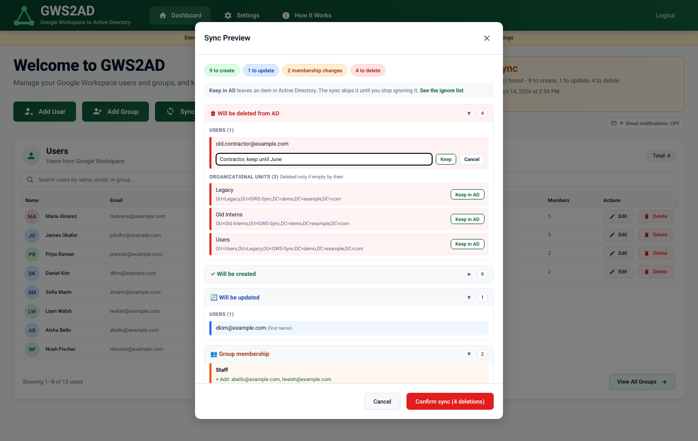

# How it works

GWS2AD is a Flask web app (Python) with a SQLite database. It reads from Google Workspace, compares with Active Directory,
shows you the difference, and applies it when you say so.

## The big idea

```
Google Workspace  ──▶  GWS2AD  ──▶  Active Directory
  source of truth     compare       follows Google
                      + preview
```

- **Google Workspace is the source of truth.** Active Directory follows it. Sync never changes Google.
- **The dashboard edits Google directly.** Add User, Edit User, Add Group and so on call the Google Admin SDK, and the AD
  side is brought into line on the next sync (the one exception is passwords, below).

## Demo mode and Live mode

Everything the app knows about the outside world comes through two "connectors": one for Google, one for AD.
`gws_connector.get_gws_connector()` and `ad_connector.get_ad_connector()` look at the saved mode (`mode.py`) and hand back either:

| Mode | Google connector | AD connector | Email |
|---|---|---|---|
| **Demo** (the default) | `mock_connectors.MockGWSConnector`, in memory | `MockADConnector`, in memory | Never sent; temp passwords are shown on screen |
| **Live** | `GWSConnector`, Admin SDK | `ADConnector`, LDAPS | Sent through your SMTP server if the dashboard toggle is on |

The pretend AD reuses the real AD class's helpers (name cleaning, password generation, OU path calculation), so Demo works out
the same OU placement Live would. The mode is stored in `connection_mode.json`. Anything missing, damaged or unrecognised means Demo.
Only the Owner can change it, with their current 6-digit code, and Live only turns on if
[a read-only connection check](#the-connection-check) passes.

## What a sync does

1. **Pull from Google:** all users, groups, group members and org units.
2. **Pull from AD:** all users and groups under the base DN.
3. **Groups.** In Google but not AD: created, in the `Groups` OU under the base DN. Description changed: updated. Same: skipped.
4. **Users.** In Google but not AD: created with a random temporary password, in an OU mirroring their Google OU, and a welcome
   email is sent if email is on. Name changed: updated. Moved to another Google OU: moved in AD (creating the OUs on the way).
5. **Group membership.** AD is re-read first, so groups created a moment ago are filled right away. Anyone in the Google group but not
   the AD group is **added**. Anyone in the AD group but not the Google group is **removed**. AD membership always ends up matching Google.
6. **Deletions.** Users and groups in AD (under the base DN) that are not in Google are deleted, **unless they are on the ignore list**.
7. **Extra OUs.** OUs under the base DN that Google's structure does not account for are deleted, **unless they are on the ignore list**, and **only if they are empty by then**
   (see [Extra OUs](#extra-ous-in-ad-but-not-in-google)).
8. Everything is logged with a timestamp. A failure on one item is recorded for that item and does not stop the rest.

Before step 1 a **backup** is written to `data_backup/backup-<date>_<time>.json`: Google users (with their groups), groups (with members) and OUs.
A failed backup is logged but does not block the sync.

### Reading the sync preview

The **Sync** button opens a preview first. Nothing changes until you press **Confirm sync**.



- **The top line** counts what the sync will do: to create, to update, membership changes, **to delete** (always shown), and ignored.
- **Deletes come first**, in red, with a **Keep in AD** button on each one. It opens a small box where you can say **why** (optional, up to 200 characters). The note shows under the item once it is ignored. The confirm button turns red and shows the number, for example `Confirm sync (4 deletions)`.
- **Creates, updates and membership** are below. Long lists show the first five with a "Show all" link, and these sections start closed unless they are short.
- **Ignored** items sit at the bottom with **Stop ignoring**. **Not deleted yet: still in use** lists OUs that Google no longer has but that still hold something.
- Everything on the ignore list is also in **Settings > Ignore list** (type, who added it, when, and the note), with search and a type filter. Notes can be added, changed or cleared there. The dashboard shows "N ignored" under the sync status.

### Matching rules

- **Users** match by email address. If an AD user has no `mail` set, its `userPrincipalName` is used, so accounts made by hand in
  Active Directory Users and Computers still match.
- **Groups** match by AD account name (`sAMAccountName`): the Google group name with spaces removed and characters AD does not allow stripped, at most 20 characters.
- The AD account name for a user is the part of the email before the `@`, cleaned the same way.

### Passwords

- A sync never compares or copies passwords.
- A password set from **Edit User** is written to Google and AD together. If the AD account is somehow missing, it is created first so the two never differ.
- New AD accounts get a 16-character random password. It is set over LDAPS (AD refuses `unicodePwd` on plain LDAP).
- Temporary passwords are never written to the log or the audit trail. With email off, the sync result shows each one **once**, in the
  browser of the person who ran the sync.

## Organizational units

OUs are mirrored from Google into AD under your base DN:

| Google OU of the user | Where the AD user goes |
|---|---|
| `/` (root) | `OU=Users,<base DN>` |
| `/Staff` | `OU=Users,OU=Staff,<base DN>` |
| `/Staff/Facilities` | `OU=Users,OU=Facilities,OU=Staff,<base DN>` |

Groups always go to `OU=Groups,<base DN>`, because Google groups do not belong to OUs. Any OU that does not exist is created when first
needed, and the preview lists the OUs it would create. In the Add User and Edit User windows an OU tree picker shows your Google hierarchy.
Changing a user's OU updates Google immediately and AD at the next sync.

### Extra OUs (in AD but not in Google)

If AD has an OU that Google's structure does not account for, for example after an OU is renamed or removed in Google, the sync deletes it. The rules:

- **Accounted for = never touched.** Each Google OU's mirror in AD, the `Users` OU inside each (and at the root), and the `Groups` OU are all "accounted for". The set is built from Google's OU list **and** from where Google's users live, so a short or empty OU list from Google cannot make a real OU look extra.
- **Only empty OUs are deleted.** The sync runs this step last, after users and groups have been moved or deleted, and checks that the OU is empty at that moment. If anything is still inside (an ignored user, a computer, another OU you ignored), the OU is kept and the log says why. That is not a failure.
- **Deepest first.** A child OU is deleted before its parent, so an emptied child frees the parent in the same sync.
- **No recursive delete.** The delete is a plain single-object LDAP delete, so AD itself refuses a non-empty OU as a second safety layer. If the app cannot check whether an OU is empty, it deletes nothing.
- **Never touched:** the base DN itself, anything outside it, and the `Domain Controllers` OU at a domain root.
- **The ignore list works for OUs** (by DN), the same as for users and groups. The preview shows each extra OU with **Keep in AD**, and lists ones that will be kept because they still hold something under "Not deleted yet: still in use".
- **A rename in Google** (for example `/Audio` to `/Audit`): the users move to the new OU (created if needed), then the old, now empty, OU is deleted in the same sync.

The service account needs the right to delete OU objects on the base DN (see [going-live.md](going-live.md#33-delegate-permissions)).

The root OU's display name is not mirrored by default (it costs an extra Google API call). A disabled `get_root_org_unit_name()` in
`gws_connector.py` explains how to turn it on.

## The directory cache

Google's lists can lag a few seconds behind a change. If the dashboard re-read Google right after you added someone, they might not appear.
`directory_cache.py` holds users, groups and membership in memory (10-minute lifetime), and each change made through the app updates the
cache in place. A "provisional" short lifetime of 20 seconds follows a change, so the next read double-checks Google. A sync clears it, which also
picks up anything changed directly in the Google Admin console.

## The connection check

Before Live turns on (and on demand), `connection_test.py` signs in to each system and reads one thing: it lists users in Google,
lists users in AD over LDAPS, and logs in to the mail server. It changes nothing, and turns common Google errors into plain advice
(for example, `unauthorized_client` means the delegation entry or scopes are wrong).

## Where things are stored

| What | Where |
|---|---|
| Accounts, roles, audit log, settings, sync status | `gw2ad.db` (SQLite) |
| All secrets | `secrets.json.enc` (encrypted), key in `.env` |
| Demo / Live | `connection_mode.json` |
| Pre-sync snapshots | `data_backup/` |
| Log files | `logs/` |
